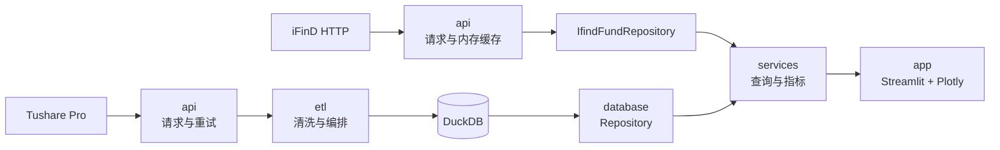

# 公募基金数据库与分析系统

本地单机的公募基金研究项目：从 Tushare Pro 采集场外基金数据存入 DuckDB，也支持切换到 iFinD HTTP 接口在线查询，通过 Streamlit + Plotly 展示净值、收益与风险指标。

项目面向个人研究与本地演示，不提供实时行情，不自动发现新基金，也不包含多人部署或任务调度。

## 快速开始

```powershell
# 1. 安装依赖
python -m venv .venv
.\.venv\Scripts\python.exe -m pip install -r requirements.txt

# 2. 在项目根目录创建 .env，写入 TUSHARE_TOKEN
# 3. 建库（不需要 Token）
.\.venv\Scripts\python.exe -m scripts.init_database

# 4. 添加基金并下载历史数据（需要 Token）
.\.venv\Scripts\python.exe -m scripts.add_fund 000001
.\.venv\Scripts\python.exe -m scripts.update_database --codes 000001

# 5. 启动页面
.\.venv\Scripts\python.exe -m streamlit run app/streamlit_app.py --server.address 127.0.0.1 --browser.gatherUsageStats false
```

更新数据库前请停止 Streamlit，避免 DuckDB 文件写锁冲突。需要批量扩充基金时，先运行 `scripts.update_fund_list` 更新总名单快照，再用 `scripts.add_fund --from-list` 生成批次。更多命令和失败处理见 [数据流程](docs/etl.md)。

## 文档索引

| 想了解 | 文档 |
| --- | --- |
| 分层、依赖方向、目录职责 | [架构说明](docs/architecture.md) |
| 添加基金、增量更新、批次、快照导入 | [数据流程](docs/etl.md) |
| 净值、收益、回撤、七项指标与对比口径 | [指标与对比](docs/metrics.md) |
| Tushare / iFinD 接口、字段、权限与接入范围 | [数据源](docs/data-sources.md) |
| 环境、测试、编码与维护约定 | [开发约定](docs/development.md) |
| 页面功能、交互与图表样式 | [页面说明](app/README.md) |
| 表结构、UPSERT、查询约定 | [数据库说明](database/README.md) |
| 探索脚本与历史报告 | [研究说明](research/README.md) |
| iFinD 调用示例 | [iFinD 示例](ifind_test/README.md) |

## 架构



页面只依赖服务层；服务层只依赖 `FundRepository` 接口。详细规则见 [架构说明](docs/architecture.md)。

## 目录

| 目录 | 内容 |
| --- | --- |
| `api/` | Tushare / iFinD 客户端、请求字段、限频与缓存 |
| `etl/` | 名单快照、分页取数、清洗、添加基金、增量更新、快照导入 |
| `database/` | 连接、表结构、UPSERT、DuckDB / CSV / iFinD 查询实现 |
| `services/` | 基金查询、日期对齐、收益回撤、七项指标、多基金对比 |
| `app/` | Streamlit 页面、组件、样式 |
| `scripts/` | 建库、更新名单、添加基金、更新数据库的命令入口 |
| `docs/` | 架构、数据流程、指标、数据源和开发约定 |
| `tests/` | 数据导入、更新、服务、指标和页面测试 |
| `research/` | 一次性数据探索与历史核查，不被正式流程依赖 |
| `ifind_test/` | iFinD 取数验证脚本 |
| `data/` | 本地数据库、快照、批次和工具，不提交 Git |
| `logs/` | 运行日志和 JSON 摘要，不提交 Git |

## 数据原则

- **主键 + UPSERT**：重复运行只更新变化记录，不产生重复业务数据。
- **保留公告版本**：净值按 `nav_date` 取最新公告；分红保留不同公告和方案版本，不把版本数当分红次数。
- **不补造数据**：缺失日期、净值、公告日保持缺失；指标条件不满足时明确标记“无法计算”。
- **事务边界**：基础资料和净值同批提交；分红、经理、资产独立提交，单项失败不影响其他数据。
- **来源可选**：页面默认读取本地数据，可切换为 iFinD 在线查询；凭证由本机环境变量或 `.env` 提供，不展示在页面中。

## 当前状态

- 运行环境：Windows、Python 3.14、项目内 `.venv`。
- 数据源：Tushare 本地数据库 / iFinD HTTP 接口，侧栏切换。iFinD 配置及首版范围见 [数据源](docs/data-sources.md#ifind)。
- 名单：`scripts.update_fund_list` 定期生成场外基金快照，供批量添加和研究使用。
- 存储：DuckDB 单文件，默认 `data/fund_database.duckdb`。
- 页面：基金分析、基金对比、数据说明。
- CSV 查询保留为对照模式，通过 `NAV_CSV` 环境变量启用。

## 开发约定

长期维护以“分层清晰、依赖单向、够用即可”为原则。新增功能前先确认归属层，避免跨层调用和不必要的抽象。完整约定见 [开发约定](docs/development.md)。
